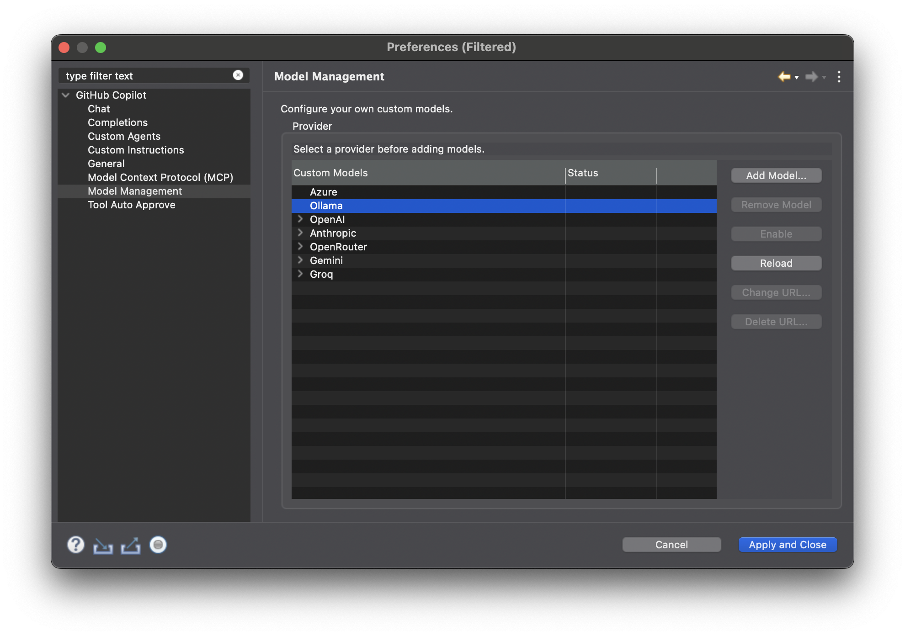
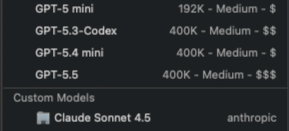

# GitHub Copilot 0.22.0 Release Notes

### Upcoming Eclipse and Java Requirements

Starting with **GitHub Copilot for Eclipse 0.23.0**, you will need **Eclipse IDE 2025-12 (4.38) or
later** and **Java 21 or later to run Eclipse**. Your projects can continue using their existing
Java versions.

**0.22.0 keeps the existing environment compatibility, including TM Terminal support**, so you
have one release to prepare. If your Eclipse or its Java runtime is below the future minimum, a
reminder appears at most once per Eclipse startup. Select **Don't remind me again** to stop
reminders for this announcement in the same Eclipse configuration. Upgrading your environment
also stops the reminder.

If you cannot upgrade, the last compatible 0.22.x installation ZIP will remain available in
[GitHub Releases](https://github.com/microsoft/copilot-for-eclipse/releases) once published.
See the [requirements and installation guidance](https://github.com/microsoft/copilot-for-eclipse#upcoming-requirements-in-0230).

---

### Context Window Size Selection
For models that offer multiple context window tiers, you can now choose the context window size directly from the model picker in Copilot Chat — switching between the default window and a larger context window when working with broader codebase context.

---

### Copilot Quick Assist for Java
In Java editors, invoking Quick Assist (`Ctrl+1` / `Cmd+1`) on problem markers now offers **Suggest fix with GitHub Copilot**. Selecting it opens Copilot Chat with the active file attached and a diagnostic prompt prefilled so you can review or customize the request before sending.

---

# GitHub Copilot 0.21.0 Release Notes

### Use Ollama Models with BYOK
You can now connect Ollama as a custom Bring Your Own Key (BYOK) model provider and use locally hosted models in Copilot Chat.

---

### Agent Skills Are Generally Available
Agent Skills are now generally available. Skills give Copilot reusable instructions and resources for specialized tasks, helping Agent Mode follow consistent workflows for your project.

---

### Sub-Agents Are Always Enabled
Sub-agent support is now always enabled in Agent Mode. Copilot can delegate focused tasks to sub-agents without requiring a separate setting, making complex work easier to parallelize.

---

### Semantic Workspace Search Removed
The semantic `@workspace` search integration has been removed. See [PR #373](https://github.com/microsoft/copilot-for-eclipse/pull/373) for details about this decision.

---

# GitHub Copilot 0.20.0 Release Notes

### Organization-Level Custom Models
Copilot for Eclipse now supports organization-enabled custom models in the model picker. If your organization has configured custom models, they appear automatically so you can select them alongside Copilot's built-in models.

---

### Faster and More Reliable Chat Rendering
The chat view now renders long and streaming conversations more efficiently, reducing slowdowns during agent sessions and editor switches.

This release also includes chat fixes so long conversations scroll correctly to the newest messages, prompts that need user action are brought into view automatically, and model details display better on Linux.

---

### Copilot Menu on the Left
The Copilot menu has moved to the left side of the Eclipse menu bar, immediately before the Help menu.
